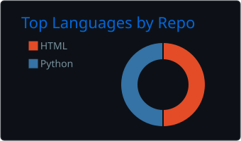
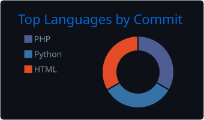

 

# Hi there! I'm Cristy Flores 👋

**Systems Engineering Student | Software Development | Data Analysis**

---

## 👩🏻‍💻 About Me

I'm a Systems Engineering student passionate about technology, software development, and finding practical solutions to real-world problems.

- 🎓 Studying Systems Engineering at UCN.
- 💻 Interested in software development, databases, and system analysis.
- 📊 Exploring data analysis and business intelligence.
- 🧪 Learning about software implementation, testing, and validation.
- 🌱 Exploring emerging technologies, including Web3.
- 💡 I enjoy learning new tools, automating processes, and building useful projects.
- ✍️ Interested in graphic design, creative projects, and technical writing.
- 🤝 Open to collaborations, volunteering, and opportunities to grow professionally.

---

## 🛠️ Technologies & Tools

### Programming & Web Development

### Databases

### Development Tools

### Design & Productivity

---

## 📊 GitHub Analytics

### My GitHub Overview

### Most Used Languages

---

## 🐍 My Contribution Activity

---

## 🤝 Let's Connect!

**Thanks for visiting my profile!** 💙

